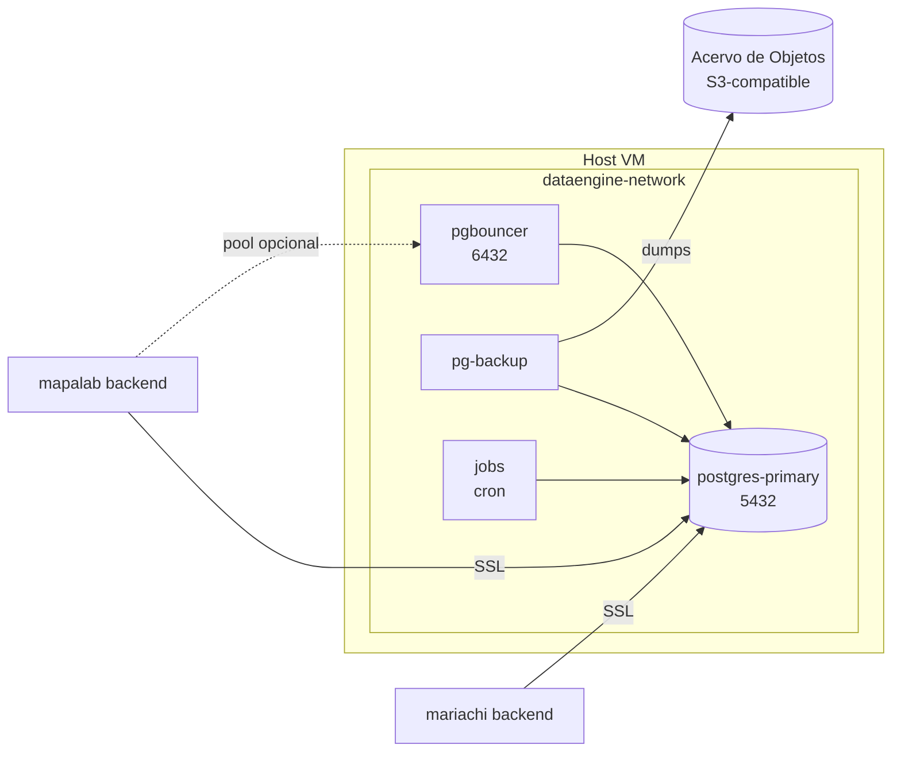

# Arquitectura

Stack PostgreSQL de produccion para MapaLab + respaldos automaticos + jobs periodicos sobre el schema `mapalab`.

## Componentes

| Servicio | Imagen | Puerto | Rol |
|---|---|---|---|
| `postgres-primary` | `postgis/postgis:18-3.6-alpine` | `5432` | BD principal (lectura/escritura), SSL, PostGIS |
| `pgbouncer` | `edoburu/pgbouncer:latest` | `6432` | Connection pooler (transaction mode) |
| `pg-backup` | build `./backup` | — | Cron de respaldos + subida al Acervo de Objetos |
| `jobs` | build `./jobs` | — | Cron container con 3 jobs diarios sobre schema `mapalab` |

Red interna `dataengine-network` (bridge). Los clientes externos se conectan a `postgres-primary` (o a `pgbouncer` para pooling).

## Diagrama

## Schema `mapalab` (v1.4.0+ de MapaLab)

Owner: rol `mariachi_layers` (editable desde mariachi admin). El rol se crea durante el bootstrap v1.4.0.

| Tabla | Proposito |
|---|---|
| `mapalab.workspaces` | 11 workspaces (alias, geoserver_workspace, db_schema) |
| `mapalab.layers` | Arbol jerarquico de capas (~250 nodos), auto-referenciada por `parent_id` |
| `mapalab.initial_layer_order` | Capas activas al cargar el visor, ordenadas |
| `mapalab.layer_tree_cache` | JSONB materializado singleton con `etag`, se regenera 04:00 |
| `mapalab.layer_metadata` | Metadata descriptiva por capa (migrado desde `public.mapalab_card`) |
| `mapalab.layer_stats` | Numeralia cacheada + `stats_config` con template catalog validado |
| `mapalab.alembic_version_dataengine` | Marcador de version del schema |

Tambien expuesta en `public`:

- `public.layer_periodicity` — periodicidad calculada por capa (funcion `public.refresh_layer_periodicity()`)
- `public.mapalab_card` — legado del Google Sheet (lectura para migracion inicial, ya no se escribe)

## Volumenes

- `${POSTGRES_PRIMARY_DATA}` → `/var/lib/postgresql/data` (primary)
- `${BACKUP_DATA}` → `/backups` (pg-backup) y `${BACKUP_DATA}/mapalab_card` → `/app/data/backups` (jobs)
- `./postgres/certs` → `/var/lib/postgresql/certs` (primary) y `/certs:ro` (pg-backup)
- `./restore` → `/restore` (primary) — dumps disponibles para `make restore`
- `./scripts` → `/scripts:ro` (primary) — SQL de mantenimiento

## Control de acceso

PostgreSQL restringe conexiones a nivel `pg_hba.conf`, generado durante init por `postgres/primary/init/00-pg-hba.sh`:

- conexiones locales dentro del contenedor
- red interna de Docker (`172.16.0.0/12`)
- IPs explicitas en `ALLOWED_HOSTS`

Si el volumen de datos ya existe, re-inicializar o copiar manualmente para aplicar cambios.

## Certificados SSL

`make certs` genera CA + cert de servidor en `postgres/certs/` (idempotente). Validez: 10 anos CA, 2 anos server. `make up` lo invoca automaticamente.
